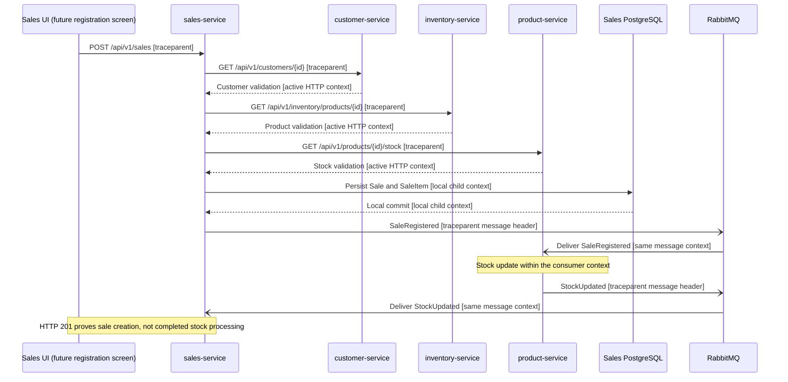

# CP1 - Critical journey and trace map

## Scope and evidence status

Journey: Register a sale and track asynchronous stock processing.
The instructor approved using the proposed architecture, as reported by the student.
The student's implemented scope is the Sales microfrontend. The supplied portal
currently contains MOCK login and a temporary Sales screen, not sale registration.
Every backend hop below is documented design; trace propagation is a workshop
proposal. No runtime trace, working backend or broker deployment is claimed.
The individual workshop prototype will focus on sales-service instrumentation.
Other services are dependencies, not implementations attributed to the student.

## Source references

Paths refer to the supplied bysellens-docs-main archive.

- `03-product/vision.md`: sales registration and history are MVP goals.
- `09-microservices/services/06-sales-service/README.md`: Sale, SaleItem,
  customer/product validation, local persistence and planned event processing.
- `07-api/contracts/openapi/sales-service.yaml`: POST /api/v1/sales.
- `07-api/contracts/openapi/customer-service.yaml`: customer detail lookup.
- `07-api/contracts/openapi/inventory-service.yaml`: active product detail lookup.
- `07-api/contracts/openapi/product-service.yaml`: current stock lookup.
- `09-microservices/services/06-sales-service/events.md`: SaleRegistered,
  StockUpdated, channels and unresolved completion/correlation semantics.
- `08-uml/diagrams/source/seq-register-sale.puml`: planned distributed sequence.

## Hop table

HTTP paths include the contracts' /api/v1 server prefix. For multiple sale items,
product and stock validation repeat for each relevant product.

| Step | Caller | Callee | Protocol | Operation | Sync/Async | Data | Proposed context |
|---|---|---|---|---|---|---|---|
| 1 | Sales UI | sales-service | HTTP | POST /api/v1/sales | Sync | customerId, paymentMethod, items | W3C traceparent header |
| 2 | sales-service | customer-service | HTTP | GET /api/v1/customers/{id} | Sync | Customer validation | W3C traceparent header |
| 3 | sales-service | inventory-service | HTTP | GET /api/v1/inventory/products/{id} | Sync | Active Product validation | W3C traceparent header |
| 4 | sales-service | product-service | HTTP | GET /api/v1/products/{id}/stock | Sync | Available Stock | W3C traceparent header |
| 5 | sales-service | Sales PostgreSQL | SQL | Persist Sale and SaleItem in one local transaction | Sync | Sale, SaleItem | Local child span; no HTTP header |
| 6 | sales-service | RabbitMQ | AMQP | Publish SaleRegistered on sales.sale-registered | Async | SaleRegistered envelope | traceparent message header |
| 7 | RabbitMQ | product-service | AMQP | Deliver SaleRegistered; process stock deduction | Async | Stock in Product-owned persistence | Extract traceparent; child consumer span |
| 8 | product-service | RabbitMQ | AMQP | Publish StockUpdated on products.stock-updated | Async | StockUpdated envelope | traceparent message header |
| 9 | RabbitMQ | sales-service | AMQP | Deliver StockUpdated; track processing | Async | Processing state design remains pending | Extract traceparent; child consumer span |

## Proposed sequence diagram

Response arrows stay within their HTTP request context; this proposal does not
require downstream responses to create new trace context. The exact timing of
HTTP 201 relative to event processing is not established by the source design.

## Proposed span tree

- Sales UI: register sale (root; one trace_id)
  - sales-service: POST /api/v1/sales (SERVER)
    - Customer validation (CLIENT -> customer-service SERVER)
    - Active product validation (CLIENT -> inventory-service SERVER)
    - Stock validation (CLIENT -> product-service SERVER)
    - Persist Sale and SaleItem (local database span)
    - Publish SaleRegistered (PRODUCER)
      - product-service: process SaleRegistered (CONSUMER; asynchronous boundary)
        - Update Product-owned stock (local span)
        - Publish StockUpdated (PRODUCER)
          - sales-service: process StockUpdated (CONSUMER; asynchronous boundary)

Each span has a distinct span_id and retains the root trace_id. Outgoing
traceparent carries the sending span's ID; the receiver creates a child span.
Consumers extract context from message headers even after the HTTP span ends.
Business correlationId, causationId and eventId do not replace trace_id.
Adding traceparent to AMQP headers is proposed instrumentation, not an existing
event-envelope field. Bearer tokens must never enter events or trace attributes.

## Failure boundary and design limitations

The downstream hop selected for CP3 propagation and the CP9 latency drill is
sales-service -> product-service, GET /api/v1/products/{id}/stock.
A prototype dependency must be identified as a test double, not a deployed service.
Sales calculates totals; Product owns current Stock; Inventory owns Product data.
A stock pre-check does not reserve units or prevent concurrent overselling.
SaleRegistered publication recovery, deduplication implementation, multi-item
completion and the transition to COMPLETED remain unresolved in the team design.
No new stock PATCH call, compensation event or gateway is introduced here.

## Source selection and documented conflicts

The student confirmed using the Sales-specific README/events and the available
contracts for this workshop: Product owns Stock; Inventory owns Product data.
The service catalog still says the domain contracts do not exist; they are present
in the archive. The architecture summary points to Inventory after RabbitMQ,
whereas Sales-specific documentation assigns sale-driven stock updates to Product.
Authentication scope also differs between the navigation map and second-cut design.
This source selection is limited to the workshop; it is not a team-wide fix.
