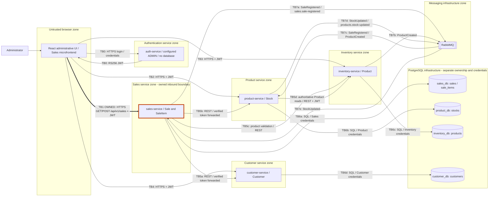

# CP1 - Attack surface and trust boundaries

Owner: Seam Yong Agudelo (@seamyong17). Team: Bysellens-Platform.
Claim: https://github.com/code-corhuila/bysellens-docs/issues/49.
Scope: inbound React Sales microfrontend -> sales-service, GET/POST /api/v1/sales.
This is the documented target architecture, not proof of deployed controls.

## Data flow

TB labels identify logical trust changes, not verified network isolation.
TB5c is described in the dependency map; the Sales contract names Customer/Product
validation and must be reconciled before implementing the exact REST call chain.
SQL boundaries include each service's database permissions even if databases share
one PostgreSQL instance. Broker credentials differ from browser JWT credentials.
There is no adopted gateway or external business API in the MVP. NEQUI is a
paymentMethod value recorded on Sale, not evidence of an external payment API.

## Asset inventory

| Asset | Location / crossing | Classification | Main consequence of compromise |
|---|---|---|---|
| ADMIN password/hash | Login request / protected Auth configuration | Restricted | Administrator impersonation |
| RSA private signing key | Auth configuration only | Restricted | Forged administrator JWTs |
| Bearer access token | React memory -> Sales and other business APIs | Restricted | Replay until token expiry |
| Sale.customerId / customer identity | React -> Sales; Customer data in customer_db | Confidential | Customer data exposure |
| SaleItem.quantity and unitPrice | Sales request / sale_items / SaleRegistered | Confidential | Fraudulent sale records and totals |
| Sale.total and paymentMethod | sales_db / sales history response | Confidential | Disclosure or corruption of commercial history |
| Stock.quantity and version | product_db: stocks / Product REST / stock events | Internal | Incorrect availability or lost stock updates |
| Product purchasePrice and salePrice | Inventory products / Product composition | Confidential | Commercial information disclosure |
| metadata.userId / correlationId | Audited events and structured logs | Internal | Loss of attribution and traceability |

Classifications are proposed for this workshop and require team confirmation.
Sales totals are server-calculated; accepting unitPrice does not define an approved
discount/pricing policy. The team must decide that policy before treating every
client-supplied price as authorized.

## Entry points of TB1

| Entry point | Caller / data | Documented authentication and authorization |
|---|---|---|
| POST /api/v1/sales | React Sales; customerId, items[{productId, quantity, unitPrice}], paymentMethod | RS256 Bearer JWT validated by Sales; ADMIN required |
| GET /api/v1/sales?page=1&limit=20 | React Sales; pagination; returns recorded Sale/SaleItem data | Same JWT and ADMIN requirement |
| GET /api/v1/health | Monitoring; adjacent public exception, outside business claim | No token; limited dependency/status response |
| Sales HTTP listener | Browser/direct callers; development allocation 8085 | Port is documented, not runtime-verified; production ingress TBD |

Missing/invalid authentication must return 401; a valid identity without ADMIN must
return 403. Client-supplied X-User-Role/X-User-Id must never grant access. The only
planned business role is ADMIN; Customers are business records, not login users.
CORS cannot replace authorization. HTTPS is required outside localhost. There is
no inbound queue/topic in TB1; RabbitMQ belongs to the adjacent TB7 boundaries.

## Evidence and limitations

Sources in code-corhuila/bysellens-docs: 03-product/vision.md;
05-architecture/overview.md; 07-api/authentication.md;
07-api/contracts/openapi/sales-service.yaml; 02-domain/domain-events.md;
09-microservices/dependency-map.md and service-catalog.md.
ADR-002/authentication and current OpenAPI supersede the older catalog's statement
that Auth is outside the MVP and that domain OpenAPI files do not exist. This
inconsistency remains in team documentation; this checkpoint does not change it.
No running Sales backend was verified. Existing runtime authentication, TLS,
audit logging, network ACLs and broker/database permissions remain unverified.
Personal CP1 reflection: pending in the student's reflection document.
